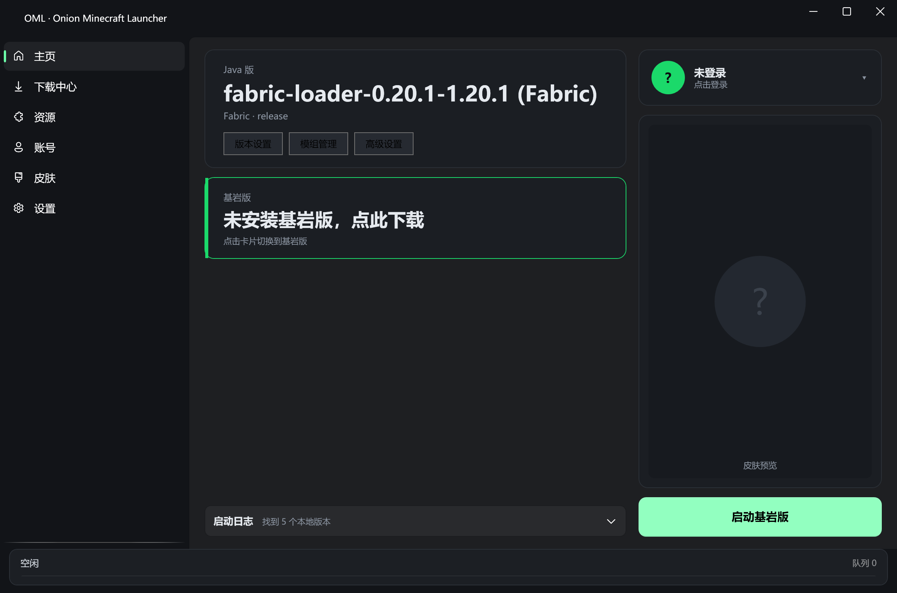
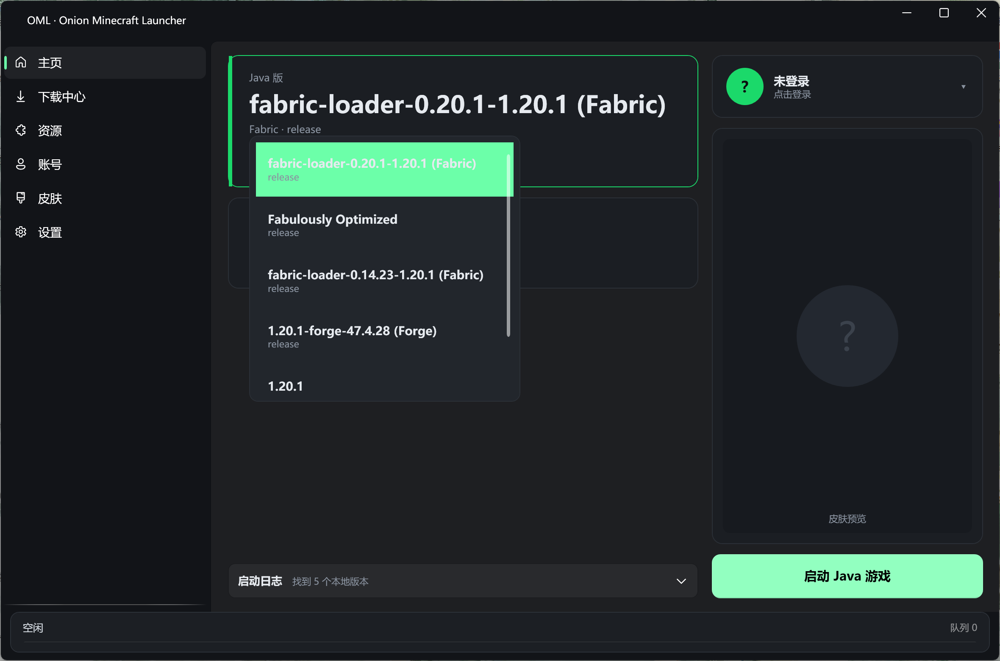
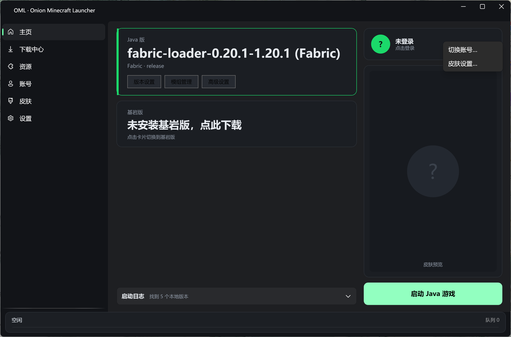
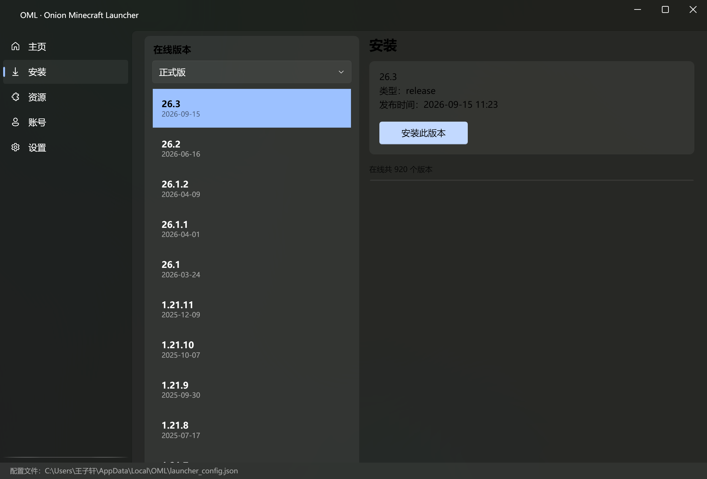
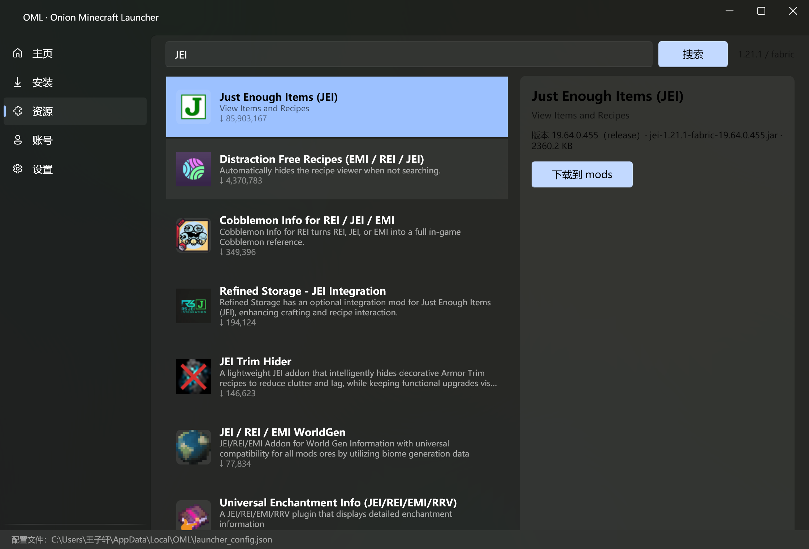

# Onion Minecraft Launcher (OML)

Windows 平台的 Minecraft 启动器。架构对标 HMCL（分层解耦），下载引擎对标 PCL2（多线程、断点续传、镜像测速）。

[注] 本启动器主要由 DeepSeek-V4.1-Flash 1017 负责开发。

当前阶段：**阶段 20 — 三栏式主界面重设计**。

| 主页（Java） | 主页（基岩） | 版本切换 |
|:--:|:--:|:--:|
|  |  |  |

| 账号菜单 | 安装 | 资源 |
|:--:|:--:|:--:|
|  |  |  |

## 解决方案结构

```
OML.sln
├─ OML.Abstractions/   # 接口与模型（不依赖任何项目）
├─ OML.Core/           # 核心逻辑，引用 Abstractions
├─ OML.Desktop/        # WPF 界面（net8.0-windows），引用 Core + Abstractions
└─ OML.Test/           # 控制台验证宿主，引用 Core + Abstractions
```

依赖方向严格单向：`OML.Desktop / OML.Test → OML.Core → OML.Abstractions`。

| 项目             | 类型          | TFM             |
|:---------------- |:------------- |:--------------- |
| OML.Abstractions | classlib      | net8.0          |
| OML.Core         | classlib      | net8.0          |
| OML.Test         | console (Exe) | net8.0          |
| OML.Desktop      | WPF (Exe)     | net8.0-windows  |

## OML.Desktop（WPF）

```
OML.Desktop/
├─ App.xaml / App.xaml.cs        # 深色主题 + 品牌强调色 + 显式初始化
├─ MainWindow.xaml(.cs)          # FluentWindow + NavigationView 外壳
├─ ViewModels/
│  ├─ ShellViewModel.cs          # 页面持有 + 导航 + 安装后刷新主页
│  ├─ HomeViewModel.cs           # 版本列表 / 启动 / 日志 / 刷新
│  ├─ InstallViewModel.cs        # 在线清单 / 类型筛选 / 一键安装
│  ├─ ModsViewModel.cs           # Modrinth 搜索 / 详情 / 下载到 mods
│  ├─ AccountsViewModel.cs       # 当前账号 + 离线 / LittleSkin 登录
│  └─ SettingsViewModel.cs       # 目录 / 内存 / 资源补全 / Java / 探测
├─ Views/Pages/                  # Home / Install / Mods / Accounts / Settings
└─ Infrastructure/
   ├─ DispatcherHelper.cs
   ├─ LauncherContext.cs         # 页面间共享配置 + 保存
   ├─ NavigationPageProvider.cs  # NavigationView 的页面工厂
   ├─ BackgroundTaskManager.cs   # 全局任务队列（串行，切页不中断）
   └─ ImageCache.cs              # 网络图标：内存 + 磁盘缓存
```

- 技术栈：WPF（net8.0-windows）+ CommunityToolkit.Mvvm 8.4.2 + WPF-UI 4.3.0（Fluent 深色）。
- 导航：`NavigationView` 原生 Page 模式。**必须注入 `INavigationViewPageProvider`**，
  否则 `Navigate(Type)` 只更新选中态、内容区保持空白。
- 强调色固定为品牌蓝 `#4C8BF5`，不跟随系统强调色（系统换成绿色会让整个界面变荧光绿）。
- 配置只有一份（`LauncherContext`）：设置页改了内存、账号页登录了新账号，主页启动立刻生效。
- 设置保存带 500ms 防抖：拖动内存滑块不会每像素写一次磁盘。
- 日志：后台线程写入缓冲区，`DispatcherTimer` 每 150ms 批量刷到 `Logs`，
  避免高频日志逐行触发 PropertyChanged 卡死 TextBox；超过 20 万字符自动截断旧内容。
- 配置目录：`%APPDATA%\OML\launcher_config.json`（与安装目录分离，更新/卸载不会误删）；
  游戏目录默认 `%APPDATA%\.minecraft`，可用 `--game-dir <path>` 覆盖。
- 安装页：在线清单 920 个版本，按正式版/快照筛选（筛选器用 **索引** 绑定，
  `SelectedItem` 字符串绑定会在 `ItemsSource` 延迟赋值时被重置）。
  安装走 `VersionInstaller`，进度条绑定 `IProgress<LaunchProgress>`，完成后自动刷新主页列表。
- 资源页：Modrinth 搜索（图标经 `ImageCache` 做内存 + 磁盘缓存、按显示尺寸解码），
  详情自动查询当前 MC 版本 + 加载器（从本地版本的加载器推断，缺省 fabric），
  下载直接落 `mods/`。
- 设置页：显示 `JavaScanner` 探测结果（路径 / 版本 / 来源），可手动重新探测。
- 主页：版本列表旁有"刷新"按钮。

### 版本隔离 / 加载器 / 任务队列

- **版本隔离**：设置页开关。开启后 `GameDirectory.GetGameRoot()` 返回 `versions/<id>/`，
  游戏存档、`mods/`、`config/`、`logs/` 全部落在版本目录内；启动工作目录与模组下载路径
  都走同一个 `GameRoot`，不会出现"设置开了但某处还写全局目录"的分裂。
- **Fabric**：`meta.fabricmc.net/v2/versions/loader/{game}/{loader}/profile/json` 直接返回
  带 `inheritsFrom` 的完整版本 JSON，落盘即可，不执行第三方 jar。
- **Forge**：下载官方 `installer.jar`，用 `java -jar --installClient` 静默安装，
  再对比 `versions/` 前后差异找出新生成的版本目录。
- **继承版本没有自己的 jar**：启动时沿 `inheritsFrom` 链找到父版本的
  `versions/<parent>/<parent>.jar` 作为客户端 jar；预检也用它，否则 Fabric/Forge 版本
  会在 `LaunchPrechecker` 处误报"缺客户端 jar"。
- **任务队列**：安装/下载统一进 `BackgroundTaskManager`（单例、串行），
  窗口底部状态条显示当前任务与进度；切到主页或设置页任务继续跑。
  支持**取消**当前任务（任务级 `CancellationTokenSource`）与失败后**重试**
  （状态条变红、出现"重试"按钮）。
- **Forge 实机**：安装器需要 `launcher_profiles.json`（缺失会报
  "There is no Minecraft launcher profile"），安装前自动补一个最小文件；
  安装器 stdout/stderr 实时写入 `logs/forge-install/oml-launch.log`。
  启动时 Forge 的 `BootstrapLauncher` 通过 `-p` 加载 client jar，
  classpath 里不能再放父版本 jar（否则 `module minecraft` 与 `_1._20._1` 冲突）。
- **模组依赖**：下载前解析版本 JSON 的 `dependencies`，对 `required` 项弹窗询问
  是否一并下载；确认后按依赖顺序排队下载到同一个 `mods/`。
  JEI 在 Modrinth 上的 required 依赖实际是 **MezzConfig**（不是 Fabric API）。
- **依赖树递归**：`ModrinthDependencyResolver` 会继续解析依赖自身的 required 依赖，
  按 projectId 去重（防循环），深度上限 8 层；下载前用缩进树展示完整链路。
  实测 JEI → MezzConfig → **Fabric API** 两层都被拉出来。
- **光影 / 整合包**：资源页按 `project_type` 切换 shader / modpack；
  光影落 `shaderpacks/`，整合包走 `.mrpack` 流程（解压 → 读 `modrinth.index.json`
  → 装原版与加载器 → 覆盖 overrides → 下载 files → 切到该实例）。
  实测 Fabulously Optimized：45 个模组、实例目录 `versions/fabric-loader-0.14.23-1.20.1`。
- **安装原子性**：安装前写 `versions/&lt;id&gt;/.installing`，成功后删除；
  启动器启动时扫描并清理带标记的半成品（只删 json/jar/natives，保留 mods/saves/config）。
- **OptiFine**：官方无公开 API，安装页提供"导入 OptiFine"按钮，
  执行 `java -jar OptiFine_x.jar` 并在结束后对比 `versions/` 找出新版本。
- **整合包实例命名**：整合包装到 `versions/<pack-slug>-<loader>-<mcver>/`，
  而不是复用加载器目录——两个都用 Fabric 0.14.23 + 1.20.1 的整合包不会再互相覆盖。
  实现方式是复制加载器版本 JSON 并改写 `id`，`inheritsFrom` 保持不变，
  所以 `GameDirectory` / `LocalVersionScanner` 不需要特殊处理。
- **单文件发布**：`dotnet publish OML.Desktop -c Release -o publish` 产出约 71MB 的
  自包含 `OML.Desktop.exe`。WPF 不支持 IL 裁剪，`PublishTrimmed` 必须为 `false`。
- **3D 皮肤预览**：`Viewport3D` 用 6 个长方体（头 8³、身 8×12×4、四肢 4×12×4）
  拼出 Steve 模型，每个面按 64×64 皮肤 UV 表取贴图，支持 64×64 / 128×128 与 64×32 旧格式；
  鼠标拖动可旋转。离线账号使用仓库内置的 `images/offline/steve.png`（编进程序集资源）。
  UV 归一化固定除以 64（高清皮肤缩放不偏移），采样前把贴图最近邻放大 8 倍并内缩半像素，
  避免线性过滤跨区域渗色导致的灰边/透明"玻璃"效果。
- **自动更新**：Velopack 1.2，启动时静默检查，发现新版本在窗口顶部显示绿色提示条，
  点"后台下载并重启更新"下载并重启。更新源可用 `OML_UPDATE_SOURCE`
  指向本地目录或 HTTP 服务，方便本地联调（详见 [docs/UPDATE.md](docs/UPDATE.md)）。

### 安装位置

**要选目录就用 `OML-win-Installer.exe`**：它是 NSIS 向导，有目录页，
内部静默调用 Velopack `Setup --installto`，自动更新链路保持不变。

Velopack 自带的两个包都没有目录页（实测）：`OML-win.msi` 只有"安装范围"，
`OML-win-Setup.exe` 只能 `--installto`。详见 [docs/INSTALL.md](docs/INSTALL.md)。

静默安装：`OML-win-Installer.exe /S /D=D:\Apps\OML`。
卸载：设置 → 应用 → OML，或 `Update.exe --uninstall`（保留 `%APPDATA%\OML` 配置与游戏数据）。

### 自动更新实测（阶段 18）

本地完整跑通了 1.0.0 → 1.0.1：

```
vpk pack -u OML -v 1.0.0 -p publish  →  OML-win-Setup.exe（75.7MB）
OML-win-Setup.exe --silent            →  %LOCALAPPDATA%\OML\current
vpk pack -u OML -v 1.0.1 -p publish-1.0.1 -o releases-1.0.1
OML_UPDATE_SOURCE=releases-1.0.1      →  启动 1.0.0
```

结果：顶部出现"发现新版本 1.0.1（当前 1.0.0）"→ 点按钮 → 下载、退出、重启，
`sq.version` 变为 1.0.1，页脚显示 `OML v1.0.1`。

### GitHub Actions 发布

`.github/workflows/release.yml`：推送 `v*` Tag 时自动发布。

1. 安装 .NET 8；
2. `dotnet publish -c Release -o publish`；
3. `dotnet tool install -g vpk`（并把 tools 目录加进 PATH）；
4. `vpk pack`（版本号取自 tag）；
5. `vpk upload github`，用内置 `GITHUB_TOKEN` 上传 Release。

发布一个新版本只需：

```powershell
git tag v1.0.2
git push origin v1.0.2
```

### 实例元数据

整合包安装时写 `versions/<id>/instance.json`：

```json
{ "name": "Fabulously Optimized", "icon": "https://cdn.modrinth.com/...png", "packVersion": "5.9.0" }
```

`LocalVersionScanner` 读取后，主页优先显示 `name` 和 `icon`（图标缺失/损坏时回退到版本 ID）。

```powershell
dotnet run --project OML.Desktop
# 指定游戏目录 / 冒烟测试 / 自动点一次启动 / 直接打开某页
dotnet run --project OML.Desktop -- --game-dir "D:\mc\.minecraft"
dotnet run --project OML.Desktop -- --smoke
dotnet run --project OML.Desktop -- --auto-launch
dotnet run --project OML.Desktop -- --nav accounts
# 自动化验证：安装指定版本 / 搜索并下载第一个结果
dotnet run --project OML.Desktop -- --install 1.8.9
dotnet run --project OML.Desktop -- --search JEI --download-first
```

## OML.Abstractions 结构

```
OML.Abstractions/
├─ Models/
│  ├─ VersionManifest.cs   # latest + versions[]（version_manifest_v2）
│  ├─ VersionDetail.cs     # id/type/mainClass/assets/arguments/libraries/downloads/logging…
│  ├─ Library.cs           # maven 坐标、artifact/classifiers、natives、rules、extract
│  └─ MavenCoordinate.cs   # 坐标解析与相对路径推导
├─ Downloads/
│  ├─ IDownloadEngine.cs        # 单任务下载契约
│  ├─ IDownloadSourceProvider.cs# 多源测速与择优
│  ├─ DownloadTask.cs           # Url / SavePath / ExpectedSize / Sha1
│  ├─ DownloadSource.cs         # 源描述（名称、基地址、优先级、是否官方）
│  ├─ DownloadUrls.cs           # URL 拼接与镜像重写
│  └─ DownloadIntegrityException.cs # SHA-1 不匹配
└─ Auth/
   ├─ IAuthService.cs  # AuthenticateAsync(type, credential)
   ├─ UserProfile.cs   # Username / Uuid / AccessToken / SkinUrl
   └─ AuthTypes.cs     # Microsoft / Offline / LittleSkin
```

## OML.Core 结构

```
OML.Core/
├─ Downloads/
│  ├─ BmclApiPathMapper.cs      # 官方地址 → BMCLAPI 地址（实测规则）
│  ├─ BmclApiSourceProvider.cs  # 双源 + 测速缓存 + 失败回退
│  ├─ MirrorSpeedTester.cs      # 并发 HEAD 测速，3s 超时
│  ├─ PclStyleDownloader.cs     # 8 块并发 / 断点续传 / SHA-1 / 重试
│  ├─ DownloadBatchRunner.cs    # 批量下载：并发上限 + 失败隔离
│  └─ OmlHttpClientFactory.cs   # 无整体超时、连接超时 10s 的共享客户端
├─ Serialization/
│  └─ OmlJsonOptions.cs         # 大小写不敏感 / 枚举字符串 / 只读配置
├─ Assets/
│  └─ AssetDownloader.cs        # 资源索引缓存 + 按 hash 补全
├─ Java/
│  ├─ JavaScanner.cs            # JAVA_HOME / 注册表 / 常见目录 / PATH 探测
│  └─ JavaRuntimeDownloader.cs  # 按 Mojang 清单逐文件下载 JRE
├─ Auth/
│  ├─ OfflineAuthService.cs     # 离线 UUID（UUIDv3）+ 随机令牌
│  ├─ MicrosoftAuthService.cs   # 设备码流 → XBL → XSTS → Minecraft
│  └─ YggdrasilAuthService.cs   # 外置登录（LittleSkin）
├─ Configuration/
│  └─ ConfigManager.cs          # launcher_config.json 读写（原子写入）
├─ Modrinth/
│  └─ ModrinthClient.cs         # 搜索 / 项目 / 版本 / 直链（无 API Key）
├─ Loaders/
│  └─ LoaderInstaller.cs        # Fabric（Meta profile）/ Forge（installer.jar）
├─ Launching/
│  ├─ LaunchSession.cs          # 门面：检查→补全→解压→预检→启动→退出
│  ├─ LaunchOptions.cs          # 启动输入与构建结果
│  ├─ LaunchArgumentBuilder.cs  # JVM 参数 + 变量替换 + 条件参数
│  ├─ LaunchPrechecker.cs       # classpath / 主 jar / natives 预检
│  └─ JvmLauncher.cs            # 拉起进程 + 日志重定向
└─ Versioning/
   ├─ GameDirectory.cs          # .minecraft 布局与版本隔离
   ├─ LocalVersionScanner.cs    # 本地版本扫描 + Forge/Fabric 识别
   ├─ VersionInstaller.cs       # 一键安装：库/jar/资源/natives/Java
   ├─ PlatformInfo.cs           # os/arch 归一（windows / x86_64 ...）
   ├─ RuleEvaluator.cs          # rules 求值（os / arch / 版本正则 / features）
   ├─ LibraryResolver.cs        # classpath + 下载任务 + natives 选择
   ├─ NativesExtractor.cs       # 解压 .dll，跳过 META-INF，防 Zip Slip
   ├─ VersionRepository.cs      # 清单抓取 + 缓存 + 继承链解析
   └─ VersionInheritor.cs       # inheritsFrom 合并
```

### 规则求值

- 无 `rules` → 允许；有 `rules` → 初始拒绝，逐条评估，匹配规则按 `action` 改写结果。
- `features` 中未声明的键按 `false` 处理（Mojang 语义），留待 UI 勾选项接线。
- `os.version` 是正则，带 200ms 超时，坏正则视为不匹配而不是崩溃。

### natives 的架构陷阱（实测发现）

1.21.1 里三条本地库：

```
org.lwjgl:lwjgl:3.3.3:natives-windows        rules: os.name == windows
org.lwjgl:lwjgl:3.3.3:natives-windows-x86    rules: os.name == windows
org.lwjgl:lwjgl:3.3.3:natives-windows-arm64  rules: os.name == windows
```

**规则完全没提架构**。只按 rules 过滤会把 x64/x86/arm64 三种 dll 一起解压到
`versions/<id>/natives/`，同名文件互相覆盖 → `UnsatisfiedLinkError`。
因此 `LibraryResolver` 按分类器后缀二次筛选，同一 `group:artifact` 只保留一个变体：
精确匹配当前架构优先，其次回退通用版；旧格式的 `natives-windows-${arch}` 占位符按 64/32 替换。

解压还有第二个坑：LWJGL 3 的 natives jar 内部是 `windows/x64/org/lwjgl/lwjgl.dll` 这种嵌套结构，
按原路径解压后 `-Djava.library.path=<natives>` 不会递归查找，游戏照样找不到 dll。
所以 `NativesExtractor` 默认**压平**到目标目录根部；同时 natives jar 也会进 classpath——
官方启动器就是这么做的（LWJGL 的 `SharedLibraryLoader` 支持直接从 jar 内加载），两条路互为兜底。

### 资源补全

- 内容寻址：落点固定 `assets/objects/<hash 前两位>/<hash>`，跨版本共享。
- 已存在且大小一致的资源直接跳过（逐个算 SHA-1 会让 3911 个资源拖垮启动速度）。
- 批量下载并发默认 16（`DownloadBatchRunner`），单个失败不中断整批，失败清单可重试。
- `AssetDownloader.DownloadAsync` 默认带 2 轮失败重试：镜像站 429 是常态，
  单轮失败就放弃会让"补全几千个资源"必然留缺口。

### 启动链路

1. **Java 探测**：`JAVA_HOME` → 注册表（`JavaSoft\JDK`、`Eclipse Adoptium`、`Microsoft\JDK` 等，64/32 位视图）
   → 常见安装目录 → `PATH`。版本用 `java -version` 实测解析：Java 8 的 `"1.8.0_381"` 折叠成 8，
   Java 9+ 直接取主版本号。绝不写死版本号（1.21.1 要 21，更新的版本已经要 25）。
2. **参数构建**：模板 JVM 参数 → 内存/品牌参数 → `-cp` → 主类 → 游戏参数。
   `${auth_player_name}`、`${game_directory}` 等全部替换；条件参数按 `rules` 求值，
   `--demo`/`--width` 由 features 决定。
3. **classpath 顺序**：客户端 jar **必须在最前面**。少了它 Java 会抛
   `ClassNotFoundException: net.minecraft.client.main.Main`，而库全都在时看起来"文件都齐了"。
4. **预检**：classpath 每个文件、客户端 jar、natives 目录里的 dll，缺任何一项立刻抛
   `LaunchPrecheckException` 并列出缺失清单。
5. **进程与日志**：`UseShellExecute=false` + `ArgumentList`（路径含空格也安全），
   stdout/stderr 同时重定向并实时落盘。

> **日志文件名是 `logs/oml-launch.log`，不是 `latest.log`。**
> 实测：启动器占住 `latest.log` 时，Minecraft 的 Log4j 会报
> `Unable to delete file ... latest.log: 另一个程序正在使用此文件`，日志轮转失败。
> `latest.log` 归游戏所有，启动器捕获的进程输出另存一份，两者互补。
> 确需覆盖可用 `new JvmLauncher(dir, "latest.log")`。

### Java 运行时下载

Mojang **不再以单个压缩包分发 Java**，而是给一份逐文件清单：

```
all.json (平台 × 组件)
  → 组件 manifest（~400 个文件）
    → 每个文件一个 piston-data 地址
```

所以 `JavaRuntimeDownloader` 的"解压"其实是按相对路径把 400 来个文件铺到
`runtimes/<component>/`（实测 `java-runtime-gamma`：403 个文件 / 87MB）。
平台键映射：`windows-x64` / `windows-x86` / `windows-arm64` / `linux` / `linux-i386` /
`mac-os` / `mac-os-arm64`。

### 版本安装与扫描

- `VersionInstaller`：解析 → 依赖库 → 客户端 jar → 资源 → natives →（可选）Java 运行时。
  用 `InstallOptions` 控制是否下载资源、`AssetLimit` 限额、是否 `EnsureJava`。
- `LocalVersionScanner`：遍历 `versions/*/<id>.json`；**坏 JSON 跳过而不是整体失败**
  （装 Forge 失败、手改文件都会留下残缺 JSON）。加载器识别靠特征库
  （`net.minecraftforge:` / `net.neoforged:` / `net.fabricmc:` / `org.quiltmc:`），
  没有特征库时退回 `inheritsFrom`。
- 规模参考：1.20.1 有 50 个依赖、3598 个资源对象（约 650MB）。测试里用
  `AssetLimit=200` 控制时长，但"完整任务列表"的断言仍然校验全量 3598 个。

### 微软登录与 Modrinth

**微软正版**（`MicrosoftAuthService`）：设备代码流，链路
`devicecode → token（轮询）→ Xbox Live → XSTS → Minecraft login → profile`。

- `Client ID` 必须是你自己注册的 Azure 应用（Entra ID → 应用注册 → 允许公共客户端流），
  通过 `OML_MICROSOFT_CLIENT_ID` 环境变量或构造参数注入。项目**不预置**任何第三方 ID。
- 轮询正确处理 `authorization_pending`（继续等）、`slow_down`（间隔 +5s）、
  `authorization_declined` / `expired_token`（终止）。
- XSTS 失败码翻译成人话：`2148916233` 无 Xbox 档案、`2148916235` 地区不支持、`2148916238` 未成年家庭组。
- `RefreshAsync` 用 refresh token 静默续期，微软轮换时保存新的 refresh token。

> **重要：Mojang 对第三方应用有白名单。**
> 自建 Azure 应用可以拿到微软令牌、也能通过 Xbox / XSTS，但调用
> `login_with_xbox` 时会返回 `403 Invalid app registration`。
> 需要在 https://aka.ms/mce-reviewappid 提交审核，通过后同一个 Client ID 才能使用 Minecraft API。
> 代码已把这个错误翻译成可执行的提示（`MicrosoftAuthService.DescribeMinecraftApiError`）。
>
> 实测链路（用真实账号授权后）：设备码 ✅ → Xbox Live ✅ → XSTS ✅ → Minecraft 登录 ❌（白名单）。
> 交互式验证：`dotnet run --project OML.Test -- --ms-login`。

**Modrinth**（`ModrinthClient`）：无 API Key，`snake_case` JSON，请求带 UA。

```csharp
var hits    = await modrinth.SearchAsync("JEI", limit: 5, projectType: "mod", gameVersion: "1.20.1", loader: "fabric");
var latest  = await modrinth.GetLatestVersionAsync("jei", "1.20.1", "fabric");
var file    = ModrinthClient.GetPrimaryFile(latest);   // file.Url / file.Hashes.Sha1
```

facets 形如 `[["project_type:mod"],["versions:1.20.1"],["categories:fabric"]]`；
429/5xx 自动重试并尊重 `Retry-After`。

**外置登录**（`YggdrasilAuthService`）：默认 `https://littleskin.cn/api/yggdrasil`。

```csharp
using var ygg = new YggdrasilAuthService();
var session = await ygg.LoginAsync(email, password);   // accessToken + 角色 + 皮肤
await ygg.RefreshAsync(session.AccessToken);           // 静默续期
var ok = await ygg.ValidateAsync(session.AccessToken); // true/false
```

- **错误码坑**：Yggdrasil 的"密码错误"和"令牌失效"都返回 **403**（`ForbiddenOperationException`），
  不是 401。判断用 `YggdrasilException.IsCredentialError`。
- 响应里的 UUID 是 32 位无连字符形态，转 `UserProfile` 时统一格式化。
- 登录后会额外拉 `/sessionserver/session/minecraft/profile/{uuid}` 解析皮肤 URL 与模型
  （`classic`/`slim`）；皮肤失败不影响登录。

### 门面与配置（UI 层契约）

```csharp
var manager = new ConfigManager(launcherRoot);          // 默认程序所在目录
var config  = await manager.LoadAsync();                // 坏文件自动备份并回退默认
config.UserProfile = await new OfflineAuthService()
        .AuthenticateAsync(AuthTypes.Offline, "Player");

using var session = new LaunchSession();
session.LogReceived += line => ui.AppendLog(line);
var info = await session.LaunchGameAsync(config, progress);
var exit = await info.WaitForExitAsync();               // ExitCode + CrashReportPath
```

- `LaunchProgress` 的 `Progress` 是**阶段内**百分比：下载 54 个库与几千个资源耗时差几个数量级，
  硬凑全局百分比只会误导用户。UI 按 `Stage` 切换文案与进度条即可。
- 进程起来立即返回；退出码与崩溃报告（`crash-reports/*.txt` 中本次启动后生成的那份）通过
  `WaitForExitAsync()` 获取。只认启动时间之后的文件，避免把上次的旧报告当成本次崩溃。
- 配置写在**启动器根目录**的 `launcher_config.json`，不进 `.minecraft`：游戏目录会被玩家
  清理或迁移，配置不该跟着丢。写入走临时文件替换，断电不会留下半截 JSON。
- 令牌用 **DPAPI**（`DataProtectionScope.CurrentUser`）加密后落盘，格式 `dpapi:<base64>`；
  历史明文自动兼容。换用户/换机器解不开时按"未登录"处理而不是崩溃。

### 版本缓存（离网可用）

| 内容       | 落点                                | 新鲜期                          |
|:---------- |:----------------------------------- |:------------------------------- |
| 版本清单   | `versions/version_manifest_v2.json` | 30 分钟（过期仍可作为断网兜底） |
| 版本详情   | `versions/<id>/<id>.json`           | 永久（内容不可变）              |
| 客户端 jar | `versions/<id>/<id>.jar`            | —                               |

任何网络异常都会回退本地缓存；无缓存才抛异常。缓存目录与游戏目录同构，不做重复存储。

### inheritsFrom 合并规则

- **libraries**：以 `group:artifact[:classifier]` 为身份键（**不含版本号**），子级覆盖父级、保留父级位置，新库追加末尾。
  按完整 `name` 判重会让同一库的多个版本同时进 classpath，运行期直接 `NoSuchMethodError`。
- **arguments**：父在前、子在后的顺序拼接。
- **mainClass**：子级非空则覆盖。
- **assetIndex / assets / downloads / javaVersion / logging**：子级缺省时继承。
- 继承链有环检测与 16 层深度上限。

### BMCLAPI 路径规则（全部实测）

| 官方 Host                          | 映射方式       | 例                                  |
|:---------------------------------- |:-------------- |:----------------------------------- |
| `launchermeta.mojang.com`          | 路径原样       | `/mc/game/version_manifest_v2.json` |
| `piston-meta.mojang.com`           | 路径原样       | `/v1/packages/<sha>/1.21.1.json`    |
| `piston-data.mojang.com`           | 路径原样       | `/v1/objects/<sha>/client.jar`      |
| `libraries.minecraft.net`          | 插入 `maven/`  | `/a/b.jar` → `/maven/a/b.jar`       |
| `resources.download.minecraft.net` | 插入 `assets/` | `/b6/<hash>` → `/assets/b6/<hash>`  |

> 注意：BMCLAPI **保留** `/mc/game/` 前缀，网上流传的"镜像没有该前缀"不成立。
> 另外 BMCLAPI 的 `/maven/` 会 302 到签名 CDN，必须允许自动重定向，且该 CDN 支持 Range。

### 下载引擎行为

- **分块**：`> 5MB` 且服务端支持 Range 时切 8 块；命中 200（服务端忽略 Range）自动退化单流。
- **续传**：每块一个 `{file}.part{i}`，续传起点 = 该文件当前长度；单流用 `{file}.part`。
- **进度**：8 块增量汇总，100ms 节流后上报 `0.0 - 1.0`；续传首帧即非零。
- **校验**：合并时流式算 SHA-1（不二次读盘），不匹配抛 `DownloadIntegrityException` 并清理。
- **重试**：默认 3 次指数退避；`429 / 503` 单独加长退避（3s 起）并尊重 `Retry-After`。
- **读超时**：单次读取/等响应头 30s 无数据即抛出并重试。`HttpClient` 整体超时设为无限，
  没有这一层兜底，僵死连接会让"正在下载"永久卡住（实测出现过 6/8 分块完成后另两块停住）。
- **限流**：分块默认错峰 120ms 启动，避免 8 个请求同时触发镜像站 429。

## 构建与运行

```powershell
dotnet build OML.sln
dotnet run --project OML.Test                     # 全量自检（约 110MB 真实流量）
dotnet run --project OML.Test -- --no-network     # 仅离线断言
dotnet run --project OML.Test -- --stage5-only    # 只跑阶段 5（复用已下载的库文件）
```
