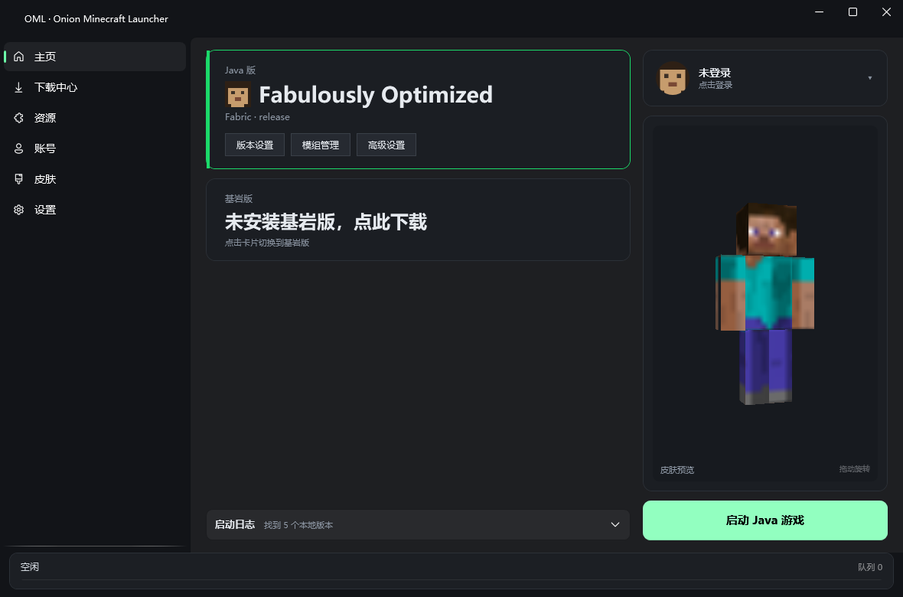
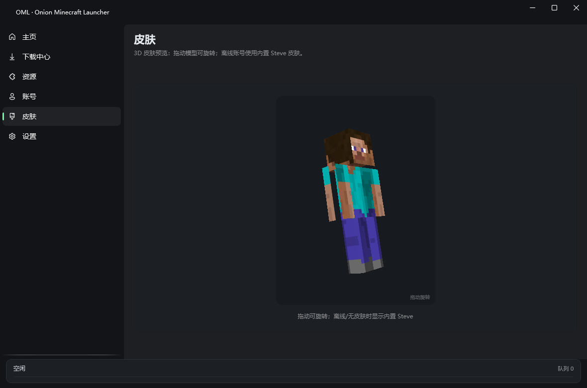

# OML · Onion Minecraft Launcher

[](https://dotnet.microsoft.com/)
[](https://learn.microsoft.com/dotnet/desktop/wpf/)
[](#)
[](LICENSE)
[](https://github.com/LSwzx/OML_test/releases)

**语言 / Languages:** **简体中文** · [繁體中文](docs/readme/README.zh-TW.md) · [简体文言](docs/readme/README.zh-classical.md) · [繁體文言](docs/readme/README.zh-classical-t.md) · [English (US)](docs/readme/README.en-US.md) · [English (UK)](docs/readme/README.en-GB.md) · [Français](docs/readme/README.fr.md) · [Deutsch](docs/readme/README.de.md) · [Русский](docs/readme/README.ru.md)

OML（Onion Minecraft Launcher）是一个面向 Windows 的 Minecraft 启动器：支持原版、Forge、Fabric、NeoForge、OptiFine 与整合包安装，
内置 Modrinth 资源搜索、自动补全 Java、损坏版本修复、Velopack 自动更新和可选的版本隔离。

启动器采用分层架构（参考 HMCL 的接口/实现解耦），下载引擎参考 PCL2 的多线程、断点续传与镜像测速思路，
界面基于 WPF-UI 的 Fluent 深色主题。

> **Disclaimer:** OML is an open-source third-party launcher. Not affiliated with Mojang Studios or Microsoft. Minecraft is a trademark of Mojang Synergies AB.
> [注] 本启动器主要由 DeepSeek-V4.1-Flash 1017 负责开发。

当前版本：**1.1.3**（正式版）



## 快速开始

### 安装

| 安装包 | 说明 |
|:--|:--|
| `OML-win-1.1.3-Installer.exe` | 带目录选择页的安装向导（推荐） |
| `OML-win-1.1.3-Portable.zip` | 免安装，解压即用 |

从 [Releases](https://github.com/LSwzx/OML_test/releases/latest) 下载即可。

安装向导会校验目录可写；装到 `Program Files` 这类受保护目录会导致后续自动更新失败，
建议选择用户可写位置（如 `D:\Apps\OML`）。安装版支持自动更新，便携版需要手动替换。

卸载：设置 → 应用 → OML → 卸载，或 `<安装目录>\Update.exe --uninstall`。
卸载会保留 `%AppData%\OML` 下的配置与游戏目录里的 `.minecraft` 数据。

### 从源码构建

环境要求：Windows 10/11 x64、[.NET SDK 8.0+](https://dotnet.microsoft.com/download)。

```powershell
git clone https://github.com/LSwzx/OML_test.git
cd OML_test

# 还原 + 构建
dotnet build OML.sln -c Release

# 运行界面
dotnet run --project OML.Desktop

# 单文件发布（自包含，约 71MB，无需安装 .NET 运行时）
dotnet publish OML.Desktop\OML.Desktop.csproj -c Release -o publish
```

WPF 不支持 IL 裁剪，`PublishTrimmed` 必须为 `false`；发布配置已在 csproj 的 Release 段设置。

自检（不联网）：

```powershell
dotnet run --project OML.Test -- --no-network
```

### 打安装包

```powershell
# 1. Velopack：生成 Setup、nupkg 与更新源
vpk pack -u OML -v 1.1.3 -p publish -e OML.Desktop.exe -o Releases --icon OML.Desktop\Assets\oml.ico

# 2. NSIS：把 Setup 包进带目录页的向导
Copy-Item "Releases\OML-win-Setup.exe" "installer\payload\" -Force
& "$env:ProgramFiles(x86)\NSIS\makensis.exe" installer\oml.nsi

# 3. 便携版
Compress-Archive publish\* OML-win-1.1.3-Portable.zip
```

发布资产需要同时上传 `Releases\OML-<版本>-full.nupkg`、`releases.win.json`、`assets.win.json`，
否则安装版的自动更新找不到更新源。

## 功能

### 版本与启动

- 在线安装原版、Fabric、Forge；支持导入 OptiFine 安装包
- 识别第三方启动器（PCL2 等）已有的版本目录，损坏 JSON 会给出具体原因而不是静默跳过
- 已有版本采用增量修复：缺库补库、缺资源补资源，绝不覆盖用户原有的 JSON / jar
- 版本隔离：每个实例拥有独立的 `mods/`、`config/`、存档与日志
- 启动参数自动生成：继承版本合并、natives 解压、classpath 与 JVM 参数
- 自动补全缺失依赖与资源；缺少 Java 时自动下载对应运行时并继续启动
- 支持离线账号、LittleSkin（Yggdrasil）登录；账号令牌使用 Windows DPAPI 加密后落盘

### 资源

- Modrinth 搜索：模组 / 光影 / 整合包
- 依赖树递归解析（required 依赖自动列出，可一并下载）
- 光影下载到 `shaderpacks/`，整合包解析 `.mrpack` 后自动安装对应版本与加载器
- 整合包写入 `instance.json`，主页显示真实名称与图标（图标本地缓存，断网可用）

### 基岩版

- 通过 Microsoft Store 解析最新正式版 / Preview 安装包，复用现有下载引擎多线程下载
- 调用 `Add-AppxPackage` 静默安装主包与依赖（VCLibs 等），无需管理员权限
- 启动前向 `entitlements/mcstore` 校验 `product_minecraft_bedrock`，未购买会明确提示
- 通过 `shell:appsFolder\<PackageFamilyName>!App` 激活游戏，主页卡片显示本地已装版本
- 未安装时点击卡片即开始下载与安装，进度进入全局任务栏
### 3D 皮肤预览

使用 [WPF-Minecraft-Skin-Viewer](https://github.com/mokkignomov-design/WPF-Minecraft-Skin-Viewer)
的 `SkinView`（MIT）：纯 WPF、零依赖，支持 Slim / Classic 与双层皮肤。
鼠标拖动旋转，空闲后自动旋转；离线账号显示内置 Steve。



### 自动更新

安装版启动后静默检查新版本（可在设置中关闭），发现新版本时窗口顶部出现提示条，
点击「后台下载并重启更新」即可升级。更新基于 Velopack，更新源为 GitHub Release 中的
`releases.win.json` 与 `OML-<版本>-full.nupkg`。

## 技术栈

- .NET 8 / WPF（`net8.0-windows`）
- CommunityToolkit.Mvvm 8.4.2
- WPF-UI 4.3.0（Fluent 深色）
- Velopack 1.2（安装包与更新框架）
- 目标平台：Windows 10/11 x64

## 项目结构

```
OML.sln
├─ OML.Abstractions/     接口与模型（无项目依赖）
├─ OML.Core/             核心逻辑：版本、下载、Java、认证、Modrinth、加载器
├─ OML.Desktop/          WPF 界面
├─ OML.Test/             控制台验证宿主
├─ installer/            NSIS 安装向导脚本
├─ docs/                 截图与文档
├─ scripts/              安装辅助脚本
└─ .github/workflows/    发布流水线
```

依赖方向严格单向：`Desktop / Test → Core → Abstractions`。

### OML.Core 主要模块

| 模块 | 职责 |
|:--|:--|
| `Versioning/` | 版本清单、继承合并、本地扫描、安装器、安装状态标记 |
| `Downloads/` | 多线程下载引擎（断点续传、SHA-1 校验、镜像测速） |
| `Launching/` | 启动参数构建、预检、natives 解压、进程管理、日志 |
| `Java/` | Java 探测（JAVA_HOME/注册表/常见目录/PATH）与官方运行时下载 |
| `Auth/` | 离线账号、微软设备码登录、Yggdrasil（LittleSkin） |
| `Modrinth/` | 搜索、项目、版本、依赖递归解析 |
| `Loaders/` | Fabric（Meta profile）与 Forge（installer.jar）安装 |
| `Skins/` | 皮肤下载与本地缓存 |
| `Serialization/` | 全局 JSON 策略（注释、尾逗号、宽容时间格式） |

## 数据位置

| 内容 | 路径 |
|:--|:--|
| 启动器配置 | `%AppData%\OML\launcher_config.json` |
| Java 运行时（自动下载） | `%AppData%\OML\runtimes\` |
| 皮肤缓存 | `%AppData%\OML\cache\skins\` |
| 默认游戏目录 | `%AppData%\.minecraft`（可用 `--game-dir` 覆盖） |

## 调试参数

```powershell
dotnet run --project OML.Desktop -- --game-dir "D:\mc\.minecraft"
dotnet run --project OML.Desktop -- --nav accounts
dotnet run --project OML.Desktop -- --smoke                  # 启动 3 秒后退出
dotnet run --project OML.Desktop -- --auto-launch            # 自动启动一次
dotnet run --project OML.Desktop -- --install 1.20.1         # 自动安装
dotnet run --project OML.Desktop -- --install-fabric 1.20.1
dotnet run --project OML.Desktop -- --search JEI --download-first --download-with-deps
dotnet run --project OML.Desktop -- --modpack fabulously-optimized
dotnet run --project OML.Desktop -- --nav home --screenshot out.png --screenshot-exit
```

`--screenshot` 用 `RenderTargetBitmap` 离屏渲染窗口内容，不依赖桌面会话是否可见，
适合自动化检查 UI。

## 版本历史

### 1.1.3（正式版）

- 新增基岩版支持：Store 解析、下载、Add-AppxPackage 静默安装、正版授权校验与 AUMID 启动
- 下载加固：30 秒读取超时、3 次指数退避重试（2/4/8s）、失败详情弹窗、60 秒卡死看门狗
- 合并社区 PR：原子写入与进度上报去重、配置字段持久化、默认游戏目录修正、整合包路径加固
- 新增 CI：每次 push / PR 自动构建并运行离线自检
- 许可证切换为 GPL-3.0-only（历史版本 MIT），README 增加多语言版本与免责声明
- 修复：PCL2 目录识别与误重装、OptiFine/launchwrapper classpath、Java 版本校验

### 1.1.2（正式版）

- 内置自动更新：安装版启动时静默检查新版本，顶部提示条可后台下载并重启升级
- 设置新增「启动时自动检查更新」开关
- 发布资产增加 Velopack 更新源（`releases.win.json`、`assets.win.json`、`*.nupkg`）
- PCL2 目录兼容：扫描诊断、JSON 容错、已有版本不再被重装覆盖
- 修复 OptiFine / launchwrapper 库缺失导致的 `ClassNotFoundException`
- 启动器图标换成 OML 洋葱 Logo（exe、窗口、安装向导一致）

### 1.1.1（正式版）

- 深色主题全局修复：账号、设置、下载等页面的深灰底黑字改为浅色文字
- 启动日志每次启动前清空，不再残留上一次内容
- 32 位 Java + 内存超过 2048MB 时启动前拦截并弹窗说明
- 启动前自动补 Java：缺少运行时（或版本过低）时自动下载并在进度条显示；
  修复配置里残留旧 Java（如 17）导致 1.21 启动报 UnsupportedClassVersionError
- 下载页改为 PCL 式向导：版本列表 → 附件面板（Forge/Fabric/OptiFine）；
  下载统一补齐完整资源，不再提供开关
- 下载底层加固：TLS 1.2/1.3、系统代理、证书链不完整时用系统证书库重建验证
- 安装/下载仍走全局任务队列，支持取消与重试

### 1.1.0（正式版）

- 全新三栏主界面：Java/基岩平台卡片、账号与皮肤、全局任务状态
- 3D 皮肤预览（Slim/Classic、双层皮肤、拖拽旋转），离线使用内置 Steve
- Modrinth 依赖递归解析与依赖树展示；光影、整合包安装
- 整合包实例独立命名与 `instance.json` 元数据，图标本地缓存
- 安装原子性：中断安装自动清理，避免半成品版本
- 任务队列支持取消与失败重试
- Velopack 自动更新、单文件发布、NSIS 安装向导（可选目录）

### 1.0.0-Alpha

首个测试版：版本安装、Fabric/Forge、资源页、账号、日志与最小启动闭环。

## 已知限制

- 微软正版登录等待 Mojang 应用白名单审核，暂未开放
- 基岩版需要微软正版账号与授权，安装包约 1GB
- Forge 启动依赖完整资源，建议安装时补全资源文件
- OptiFine 官方安装器没有静默参数，只能通过导入方式启动图形安装

## 参与贡献

欢迎提交 Issue 与 PR。环境要求、提交信息格式（中文 `feat` / `fix`）、PR 流程见
[CONTRIBUTING.md](CONTRIBUTING.md)。

## 第三方组件

- WPF-Minecraft-Skin-Viewer（MIT）：`OML.Desktop/Controls/SkinView.cs`，
  版权与许可全文见 [THIRD_PARTY_NOTICES.md](THIRD_PARTY_NOTICES.md)

## 许可

本项目基于 [GNU General Public License v3.0 only](LICENSE)（GPL-3.0-only）开源，
Copyright (C) 2026 LSwzx。

你可以自由使用、修改和分发本软件，但分发时必须提供完整源代码，并以相同许可证授权衍生作品。
详见 [LICENSE](LICENSE) 全文。

> Note: Versions prior to v1.0.2 were released under the MIT License. Future versions are licensed under GPL-3.0.
